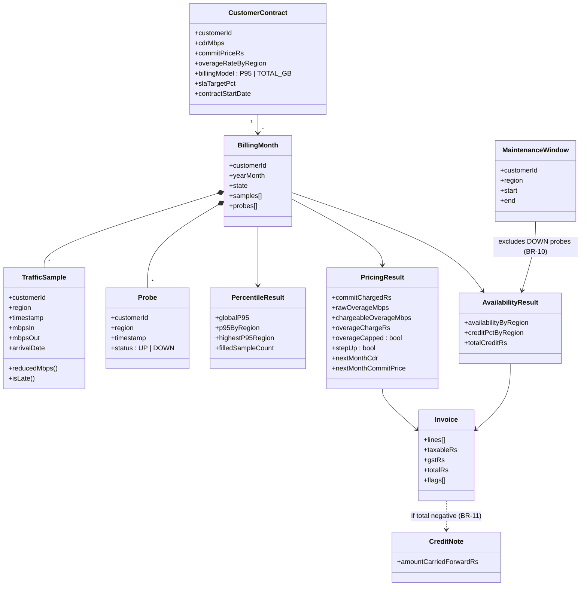
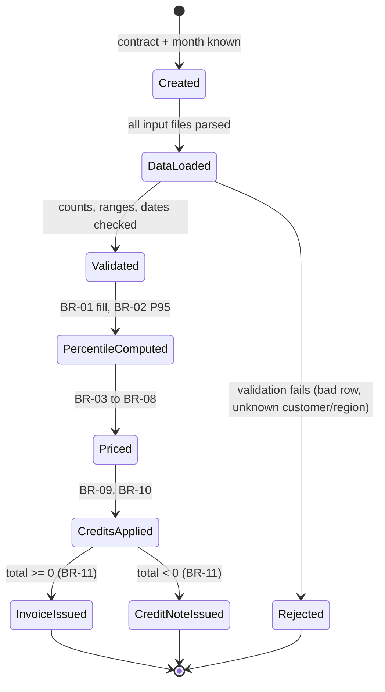

# Design Document — Week 1 (Draft v1, for team review)

**Capstone Project — 10 SECONDS Placement Training, Christ University**
**Team:** AI-043 · **Section:** 6BTCSAIML A
**Problem Statement:** PS-160 — CDN and Bandwidth Billing with 95th Percentile, Committed Data Rate and SLA Credits
**Domain:** Enterprise IT — Network Services · **Difficulty:** Medium-High
**System type:** Command-file driven program. No UI.

| Member | Register No. | Proposed module ownership (see §8) |
|---|---|---|
| SABHARIMANIVEL B | 2462187 | M1 Ingestion & Validation, M2 Percentile Engine |
| SHERWIN RICHARD RANJITH | 2462190 | M3 Pricing Engine (commit, burst, overage, cap, step-up) |
| SHOMIK SAHU | 2462191 | M4 SLA & Availability, M5 Invoicing & Reporting |

**Language: Python 3.10+ — LOCKED 17 Nov 2026** (confirmed by Sherwin; team to ratify at first team meeting — see §9 for the reasoning). One language per team; this choice must not change after Week 1.
**Status of this draft:** Built only from the three official emails (announcement 3 Nov 2026, team assignment 4 Nov 2026, reminder 17 Nov 2026). Sample data and expected outputs arrive in Week 2 — file formats in §5 are therefore *assumptions*, isolated behind the ingestion module so they can change without touching the billing logic. Open questions for the organisers are in Appendix B — they must be asked by replying on the *assignment email thread only*.

---

## 1. What we are building

The billing engine a CDN / ISP finance team runs once a month for every enterprise customer:

1. Load customer contracts.
2. Ingest 5-minute traffic samples and availability probes for the month.
3. Reduce the samples to a monthly **95th-percentile rate (P95)** per customer — per region and globally.
4. Price the commit, burst and overage; compute SLA credits for missed availability; apply caps and pro-rata rules.
5. Print an **itemised invoice per customer in Rs with GST**, or a **credit note** where credits exceed charges.
6. Print traffic and availability summaries on demand.

Correctness is judged to the rupee against hidden expected outputs, so every calculation uses exact decimal arithmetic (`Decimal` in Python), never binary floating point, and every business rule is implemented in exactly one place, in the order given in §6.

---

## 2. Glossary

| Term | Meaning |
|---|---|
| CDN / ISP | The seller whose network the customer uses; the party issuing the invoice. |
| Sample | One 5-minute traffic reading for a customer in a region: timestamp, Mbps in, Mbps out. A 30-day month has 288 samples/day × 30 = **8,640** expected samples per region stream. |
| Reduced sample | `max(in, out)` for a sample (BR-01). All percentile maths uses reduced samples. |
| P95 (95th percentile rate) | The billable bandwidth rate for the month, derived by BR-02. The top 5% of samples are discarded so short spikes do not set the month's rate. |
| CDR | Committed Data Rate (Mbps) in the contract — the rate the customer commits to pay for whether they use it or not. |
| Commit price | The fixed monthly price for the CDR (Rs), paid regardless of usage (BR-03); pro-rated only for a mid-month start (BR-07). |
| Overage (raw) | `max(0, P95 − CDR)` Mbps (BR-03). |
| Burst allowance | The first 10% of CDR worth of overage is free (BR-04). Chargeable overage = `max(0, P95 − 1.10 × CDR)`. |
| Overage cap | Overage charge may not exceed 2× the commit price; any excess is waived and flagged `OVERAGE_CAPPED` (BR-06). |
| Region | One of India, Singapore, Europe — each with its own overage rate (BR-05) and its own P95 and availability. |
| Total-GB model | Alternative billing model in the contract: charge per GB transferred instead of per-Mbps overage, first 1,000 GB/month free (BR-05). |
| Probe | One availability check for a customer in a region: timestamp, UP or DOWN. |
| Availability | `UP probes ÷ total probes` for a customer-region-month, after maintenance exclusions (BR-09, BR-10). |
| SLA credit | A percentage of the commit price credited back when availability falls below the 99.9% target (BR-09). |
| Maintenance window | A file-supplied scheduled-downtime interval; DOWN probes inside it are excluded from availability, subject to a 4-hour limit (BR-10). |
| STEP_UP | Automatic CDR increase for the *next* month after two consecutive months with P95 > 150% of CDR (BR-08). |
| Credit note | Issued instead of an invoice when commit + overage − credits is negative; the amount carries forward. Never a negative invoice (BR-11). |
| Late sample | A sample arriving after the 3rd of the following month: excluded from billing, counted in the traffic summary flagged `LATE` (BR-12). |
| Billing month | The (customer, calendar month) unit the whole pipeline runs on; the main entity of this design (§4). |

---

## 3. Business Rule Register

Each rule is stated as given in the assignment brief, with the module that owns it and the test idea that proves it. **No rule may be implemented in two places.**

| ID | Rule (as briefed) | Owner | Key test |
|---|---|---|---|
| BR-01 | Reduce each sample to `max(in, out)`. If a customer has fewer than 95% of the expected samples in a month, fill the missing samples with the customer's monthly median (of reduced samples) *before* the percentile calculation. | M2 | 8,640 samples → no fill; 8,207 samples in a 30-day month → fill triggers |
| BR-02 | P95: sort the month's samples descending, discard the top 5% (`floor(count × 0.05)`), the next value is the billable rate. Per-region P95 uses only that region's samples. | M2 | Hand-computed 20-sample and 8,640-sample sets, global and per-region |
| BR-03 | Commit price is paid regardless of usage. Raw overage Mbps = `max(0, P95 − CDR)`. | M3 | P95 below CDR → overage 0, commit still charged in full |
| BR-04 | Overage up to 10% of CDR is free. Overage beyond 10% is priced at the overage rate of the region where the P95 was highest. | M3 | P95 exactly 110% of CDR → chargeable overage 0 |
| BR-05 | Overage rates: India Rs 450/Mbps, Singapore Rs 650/Mbps, Europe Rs 800/Mbps. Total-GB model: Rs 4.50/GB India, Rs 6/GB elsewhere, first 1,000 GB/month free. | M3 | Highest-P95 region = Europe while most traffic is India → Europe rate applies |
| BR-06 | Overage charge ≤ 2× commit price. Excess is waived and printed as `OVERAGE_CAPPED`. | M3 | Charge above cap → capped amount + flag on the invoice |
| BR-07 | Mid-month contract start: commit price pro-rated by calendar days. CDR is **not** pro-rated; the free burst allowance is **not** pro-rated. | M3 | Start on the 31st of a 31-day month → commit = price × 1/31 |
| BR-08 | If P95 > 150% of CDR for 2 consecutive months, next month's CDR steps up to 125% of the old CDR and the commit price scales proportionally (×1.25). Print `STEP_UP`. | M3 | Prior-month P95 file with two months >150% → STEP_UP with new CDR/price |
| BR-09 | Availability per region = UP ÷ total probes; target 99.9%. Credit (as % of commit price): 10% for 99.5–99.9%, 25% for 99.0–99.5%, 50% below 99.0%. Credits are per region, summed, capped at 50% of commit price. | M4 | Availability exactly 99.9000% → no credit; 99.8999% → 10% tier |
| BR-10 | DOWN probes inside a scheduled maintenance window (file-supplied, max 4 hours/month) are excluded from availability. A window longer than 4 hours counts fully as DOWN beyond the 4th hour. | M4 | Window of 4 h 5 min → last 5 minutes of DOWN probes count |
| BR-11 | Invoice = commit + overage − credits, then GST 18%. Credits reduce the taxable value. If the total is negative, issue a credit note carrying forward — never a negative invoice. | M5 | Credits > commit with zero overage → credit note, no invoice |
| BR-12 | Samples arriving after the 3rd of the following month are ignored for billing but counted in the traffic summary with a `LATE` flag. | M1/M2 | Late sample changes the summary count, not the P95 or invoice |

**Tier boundaries (our reading, to confirm — Appendix B):** availability in [99.5%, 99.9%) → 10%; [99.0%, 99.5%) → 25%; < 99.0% → 50%; ≥ 99.9% → 0%. Exactly 99.5% therefore earns 10%, not 25%.

---

## 4. Domain model — class diagram



Design notes:
- **Money is `Decimal`, rates are `Decimal`.** No float anywhere in a money or percentile path.
- `BillingMonth` is the aggregate everything hangs off: one customer, one calendar month, one run of the pipeline.
- The five engines (M1–M5) are pure functions over `BillingMonth` + contract: same input → same output, no hidden state. That is what makes every BR individually testable and viva-modifiable.
- Prior-month P95 history (needed for BR-08) is an input file to `BillingMonth`, not stored state.

## 5. Inputs, commands and outputs (assumed formats — to be confirmed in Week 2)

**Input files:** contracts (JSON), samples (CSV, ~200,000 rows for 8 customers × 3 regions × 1 month), probes (CSV), maintenance windows (CSV), prior 2 months of P95 per customer (for BR-08). Sample data and expected invoices for 5 of 8 customers arrive in Week 2; the other 3 are hidden evaluation data — so **nothing may be hard-coded to a customer, region or month**.

**Command-file driven** (no UI). Proposed command set — the parser is isolated in M1 so a different command format costs one module, not a rewrite:

```
LOAD_CONTRACTS <file>
LOAD_SAMPLES <file>
LOAD_PROBES <file>
LOAD_MAINTENANCE <file>
LOAD_PRIOR_P95 <file>
RUN_BILLING <yyyy-MM>
PRINT_INVOICE <customerId>
PRINT_TRAFFIC_SUMMARY <customerId>
PRINT_AVAILABILITY_SUMMARY <customerId>
```

**Invoice (itemised, per customer):** commit charged (with pro-rata note if BR-07 applies), P95 global and per region, overage Mbps, chargeable overage Mbps, rate applied and the region it came from, overage Rs, `OVERAGE_CAPPED` if BR-06 fired, SLA credits by region, taxable value, GST 18%, total — or a credit note (BR-11). `STEP_UP` line with next month's CDR and commit price when BR-08 fires.

## 6. Calculation pipeline — order matters

The brief explicitly expects us to explain *why* the steps run in this order:

1. **Reduce** each sample to `max(in, out)` (BR-01), separate late samples (BR-12).
2. **Fill** missing samples with the monthly median if coverage < 95% (BR-01) — filling must happen *before* sorting, or the percentile is computed on a short, biased set.
3. **P95**, global and per region (BR-02).
4. **Raw overage** = `max(0, P95 − CDR)` (BR-03).
5. **Burst allowance** removes the free first 10% of CDR (BR-04) — allowance before pricing, because free usage must never be priced.
6. **Price** chargeable overage at the rate of the highest-P95 region (BR-05), or price total GB above the free 1,000 GB for total-GB customers.
7. **Cap** the priced overage at 2× commit (BR-06) — the cap is a ceiling on a *charge*, so it can only apply after pricing; capping Mbps before pricing would give a different (wrong) rupee value whenever the rate differs by region.
8. **Pro-rate** the commit if the contract started mid-month (BR-07); check **step-up** against prior months (BR-08, affects next month, printed now).
9. **Availability and credits** per region after maintenance exclusions (BR-09, BR-10).
10. **Invoice:** (commit + overage − credits) → GST 18% → total, or credit note if negative (BR-11).

Worked micro-example for the viva: 20 reduced samples sorted descending — discard `floor(20 × 0.05) = 1`, the 2nd value is P95. With CDR 100 Mbps and P95 130 Mbps: raw overage 30, free burst 10, chargeable 20 Mbps; if Europe had the highest regional P95, 20 × Rs 800 = Rs 16,000, then the 2×-commit cap is checked against that Rs figure.

## 7. State diagram — main entity: BillingMonth / Invoice



A run never edits an issued invoice: corrections are a fresh run of the same `BillingMonth`. `STEP_UP` and `OVERAGE_CAPPED` are flags printed on the invoice, not states.

## 8. Module ownership (proposed — team to confirm and record)

| Module | Contents | BRs | Owner |
|---|---|---|---|
| M1 Ingestion & Validation | File loaders (contracts/samples/probes/maintenance/prior P95), command parser, validation and error messages, late-data separation | BR-12 (detection) | SABHARIMANIVEL B |
| M2 Percentile Engine | Sample reduction, expected-sample count, median fill, global + per-region P95 | BR-01, BR-02 | SABHARIMANIVEL B |
| M3 Pricing Engine | Commit & pro-rata, burst, regional / total-GB pricing, overage cap, CDR step-up | BR-03 – BR-08 | SHERWIN RICHARD RANJITH |
| M4 SLA & Availability | Probe aggregation, maintenance exclusions, availability, credit tiers and cap | BR-09, BR-10 | SHOMIK SAHU |
| M5 Invoicing & Reporting | Invoice / credit-note generation, GST, traffic & availability summaries, output formatting | BR-11 (+ BR-12 flag in summary) | SHOMIK SAHU |

Each member writes the tests for their own BRs, commits to the repository themselves, and must be able to modify their module live in the viva — that is why the split is by rule, not by "front half / back half" of the code.

## 9. Language decision (proposed)

| | Python 3.10+ | Java 17+ |
|---|---|---|
| Rule correctness (40 marks) | `Decimal`, stdlib `csv`/`json`, sorting 200k rows is trivial | Equally capable, more boilerplate per rule |
| Tests (single command) | `pytest` — one command | JUnit — one command, more setup |
| Viva live code change | Small, readable functions; fastest safe edit under pressure | Safer typing, slower to edit |
| Risk | Team must be disciplined about types/validation | Verbosity can hide rule errors in ceremony |

**Decision: Python — locked 17 Nov 2026.** The marking rewards correct rules and fast, explainable changes, not enterprise ceremony. Tests are written with the stdlib `unittest` framework so the suite runs with a single command and zero installed dependencies (and can also be collected by pytest).

## 10. Edge cases — how each is handled

| Edge case (from brief) | Handling |
|---|---|
| Exactly 8,640 samples in a 30-day month vs 8,207 | 8,640 = full coverage, no fill. 8,207 < 8,208 (= 95% of 8,640) → median fill of the 433 missing samples before P95 (BR-01). |
| P95 exactly 110% of CDR | Chargeable overage = `max(0, P95 − 1.10×CDR)` = 0 (BR-04). Boundary is inclusive-free. |
| Highest-P95 region is Europe, most traffic is India | Overage is priced entirely at Europe's Rs 800/Mbps — pricing follows the highest-P95 region, not traffic share (BR-04/05). |
| Availability exactly 99.9000% vs 99.8999% | 99.9000% meets target → no credit. 99.8999% → 10% tier. Comparison is done on the exact fraction, never on a rounded display value (BR-09). |
| Maintenance window of 4 h 5 min | First 4 hours of DOWN probes excluded; the final 5 minutes count as DOWN (BR-10). |
| Contract starts on the 31st of a 31-day month | 1 billable day: commit × 1/31. CDR and burst allowance stay full-size (BR-07). |
| Second consecutive month above 150%, ending in a month where STEP_UP already applied | Step-up must not stack repeatedly on the same trigger — history is re-evaluated against the *current* CDR each month; see open question Q6, Appendix B. |
| Credits exceed commit when overage is zero | commit + 0 − credits < 0 → credit note carrying the amount forward, GST not charged on a negative value (BR-11; see Q4). |

## 11. Validation plan (Week 3 completes this)

- Every BR has at least one unit test named after it (`test_br01_…`, `test_br02_…`, …) — test coverage per rule ID is an explicit evaluation item.
- Every edge case in §10 has its own test.
- Golden-file test: once Week-2 sample data and the 5 visible expected invoices arrive, the full run must reproduce them to the rupee before any hidden-data run is trusted.
- Invalid input (unknown region, negative Mbps, duplicate timestamps, probe for unknown customer) → clear error naming the file and row, never a silent skip.

## 12. Decision log (starter — keep to 10–20 one-line entries in the repo)

1. Python 3.10+ chosen over Java 17+ — faster, clearer live edits in the viva; stdlib covers all file formats. *Locked 17 Nov 2026.*
2. All money and rates as `Decimal` — binary float cannot be trusted to the rupee.
3. Engines are pure functions over `BillingMonth` — every BR is testable in isolation.
4. Command parser isolated in M1 — the brief fixes no command format, so the format must be cheap to change.
5. Availability compared as an exact fraction, not a rounded percentage — the 99.9000 / 99.8999 edge case depends on it.
6. Median fill uses reduced samples only — BR-01 defines the sample value as `max(in, out)` before any fill.
7. Overage cap applied to the priced Rs amount, not to Mbps — the brief caps the *charge* at 2× commit price.
8. Total-GB volume per sample = reduced Mbps × 300 s ÷ 8 ÷ 1,000 (GB, decimal) — assumption, pending Q2.
9. Nothing hard-coded per customer/region/month — 3 of 8 evaluation customers are hidden.
10. Invoice is never mutated after issue — corrections are a re-run, keeping outputs reproducible.

---

## Appendix A — Submission checklist (from the briefs)

- [ ] Week 1: this design document submitted/reviewed — glossary, class diagram, state diagram, BR register, module ownership. **No code until the design is submitted and reviewed.**
- [x] Language fixed (one per team): **Python 3.10+** — locked 17 Nov 2026.
- [ ] Repository created, named exactly **AI-043-PS-160** (GitHub/GitLab), all three members committing.
- [ ] Week 2 checkpoint: repo link shared **by replying to the assignment email** (4 Nov thread). All later checkpoints are read from the repo.
- [ ] Week 2: sample data received (contracts JSON; samples CSV ~200k rows; probes CSV; maintenance CSV; prior-2-months P95; expected invoices for 5 of 8 customers).
- [ ] Final (Week 4): README (how to run), design document (PDF), test suite runnable with a single command, decision log (10–20 entries), 5-minute demo video link — all in the repo.
- [ ] Final submission email: reply on the assignment thread, subject **"AI-043 – Final Submission"**.
- [ ] Queries only on the assignment thread — a separate email will not be tracked.
- Rules to remember: team changes not permitted · evaluation /100 (business-rule correctness 40, domain design 20, validation 15, tests 10, code quality & Git hygiene 5, viva 10) · **minimum 50 to pass** · code similarity above 40% with another team = fail · inability to modify your own code live in the viva = fail.

## Appendix B — Clarification questions (draft — send on the assignment thread)

1. **Median fill (BR-01):** is the monthly median computed per customer globally or per region, and for an even sample count is it the mean of the two middle values? Are filled samples added up to the full expected count?
2. **Total-GB model (BR-05):** how is GB derived from 5-minute Mbps samples (we assume reduced `max(in,out)` × 300 s, decimal GB), and does the commit price still apply in full alongside the GB charge?
3. **Maintenance cap (BR-10):** is the 4-hour exclusion a total per month or per window?
4. **Credits and cap bases (BR-06/09/11):** are SLA credit percentages and the overage cap calculated on the full commit price or the pro-rated commit in a mid-month-start month? If commit + overage − credits is negative, is the credit note the pre-GST amount?
5. **Contract vs brief rates:** contracts carry an overage price per region — if it differs from BR-05's Rs 450/650/800, which wins? Likewise the contract's SLA target vs the fixed 99.9% in BR-09.
6. **Step-up (BR-08):** after a STEP_UP, does the two-month history reset, and is the stepped-up CDR/commit used in any current-month figure or only printed for next month?
7. **Late data (BR-12):** which field marks a sample's arrival date (as opposed to its measurement timestamp)?
8. **"Caps and minimums":** the core requirements mention minimums, but no minimum rule appears in BR-01–BR-12 — is there a minimum charge beyond the commit itself?
9. **Output format:** is there a required invoice layout/template the expected outputs follow, or is any itemised layout with the same figures acceptable?
10. **Checkpoint dates:** please confirm the Week 2 checkpoint date, final submission deadline and viva schedule for Team AI-043.

*Draft prepared 17 Nov 2026 from the three official 10 SECONDS emails. Names, register numbers, team ID, problem statement and all rule values were cross-checked against the assignment email of 4 Nov 2026.*
